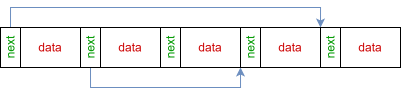

# Hashmap

Hashmap is a fixed-size, array-backed hash table for C with caller-defined element types
and optional thread safety. Collisions use index-linked chains inside the same array,
avoiding separate per-element node allocations.

Hashmap - хеш-таблица фиксированного размера на C с хранением элементов в массиве,
пользовательским типом данных и необязательной потокобезопасностью. Коллизии разрешаются
цепочками индексов в том же массиве без отдельных выделений памяти под узлы.

## Описание

Коллизии представлены цепочками индексов внутри того же массива, а не отдельно выделяемыми узлами связного списка. Таблица сама хранит служебное поле `int32_t next` рядом с каждым пользовательским элементом, поэтому изменять тип данных пользователя не требуется. Функции хеширования и сравнения работают только с пользовательскими данными.

Такая схема рассчитана на предсказуемое выделение памяти и быстрый доступ в программах, где максимальный размер таблицы можно выбрать заранее. Для кода с параллельным доступом доступна потокобезопасная сборка.



## Содержание

- [Разработка и проверка изменений](#%D1%80%D0%B0%D0%B7%D1%80%D0%B0%D0%B1%D0%BE%D1%82%D0%BA%D0%B0-%D0%B8-%D0%BF%D1%80%D0%BE%D0%B2%D0%B5%D1%80%D0%BA%D0%B0-%D0%B8%D0%B7%D0%BC%D0%B5%D0%BD%D0%B5%D0%BD%D0%B8%D0%B9)
- [Сборка](#%D1%81%D0%B1%D0%BE%D1%80%D0%BA%D0%B0)
- [Подключение](#%D0%BF%D0%BE%D0%B4%D0%BA%D0%BB%D1%8E%D1%87%D0%B5%D0%BD%D0%B8%D0%B5)
- [Устройство](#%D1%83%D1%81%D1%82%D1%80%D0%BE%D0%B9%D1%81%D1%82%D0%B2%D0%BE)
- [Статья](#%D1%81%D1%82%D0%B0%D1%82%D1%8C%D1%8F)
- [Лицензия](#%D0%BB%D0%B8%D1%86%D0%B5%D0%BD%D0%B7%D0%B8%D1%8F)

## Разработка и проверка изменений

**Опорные символы для изменения поведения:**

1. `array_hashmap_init`, `array_hashmap_del` - создание и освобождение контейнера; публичные
   объявления находятся в `include/array_hashmap.h`.
1. `array_hashmap_set_func`, `array_hashmap_add_elem` - настройка callback-функций и вставка;
   сверяйте заголовок, реализацию `src/array_hashmap.c` и сценарии в `test/test.c`.
1. `array_hashmap_find_elem`, `array_hashmap_del_elem`, `array_hashmap_del_elem_by_func` - поиск
   и удаление; при правках проверьте варианты возврата и владение данными.

**Основные точки изменения:**

- `include/array_hashmap.h` - публичный интерфейс и определения типов;
- `src/array_hashmap.c` - реализация операций и синхронизации;
- `test/test.c` - проверка операций хеш-таблицы.

**Файлы сборки:** `CMakeLists.txt` определяет цель библиотеки и тестовую программу, `CMakePresets.json` - профили конфигурации CMake. Изменения API согласуйте с заголовком и тестом независимо от профиля сборки.

**Проверка изменений:** При изменении публичного API согласуйте заголовок,
реализацию и `test/test.c`. Правила владения памятью и индексов цепочек
проверяйте отдельно от потокобезопасности; команды сборки и теста приведены ниже.

**Типовые изменения:** Для поведения повторной вставки смотрите
`array_hashmap_add_elem` и обратный вызов `on_already_in`: существующее
значение может сохраняться или заменяться. Для поиска и удаления проверяйте
соответствующие hash/cmp callbacks в `array_hashmap_set_func`.
Модуль копирует данные элемента в собственный массив, но не управляет
ресурсами, на которые могут указывать поля самого элемента.

## Сборка

Обычная статическая библиотека:

```sh
cmake --preset release
cmake --build --preset release
```

Результат:

```text
build/release/libhashmap.a
```

Thread-safe target:

```sh
cmake --preset release
cmake --build build/release --target hashmap_threadsafe
```

Он компилируется с `THREAD_SAFETY`.

## Подключение

Репозиторий можно подключить через `add_subdirectory()` или собрать библиотеку отдельно и линковать ее вручную.

Публичный API находится в:

```text
include/array_hashmap.h
```

Примеры использования и benchmark/test code находятся в [`test/test.c`](test/test.c).

Собрать тестовый target:

```sh
cmake --build build/release --target hashmap_test
```

## Устройство

Таблица выделяется единым массивом фиксированного размера. При коллизии элементы связываются индексами внутри этого же массива, поэтому дополнительные heap allocations на каждый collision node не требуются.

Hash/comparison callbacks для add/find/delete можно задавать отдельно, что позволяет использовать одну структуру с разными способами поиска по данным.

**Контракт API:** `array_hashmap_init(map_size, max_load, type_size)` возвращает
`NULL` при неположительных размерах или `max_load` вне интервала `(0, 1]`.
Перед операциями необходимо задать соответствующие hash/cmp callbacks через
`array_hashmap_set_func()`. Таблица хранит копии пользовательских элементов;
заполнение сверх `map_size * max_load` возвращает `array_hashmap_full`.
Коды результата и сигнатуры задаются в `include/array_hashmap.h`.

**Повторный вход из callback:** при сборке с `THREAD_SAFETY` обработчик
`on_already_in` в `array_hashmap_add_elem()` вызывается до освобождения
`pthread_rwlock_t`. Не вызывайте из такого обработчика операции над той же
таблицей: повторный захват блокировки может привести к зависанию.
`max_size` вычисляется как целая часть `map_size * max_load`; при малом
`max_load` даже созданная таблица может не принимать новые элементы.

**Параллельность:** сборка с `THREAD_SAFETY` использует `pthread_rwlock_t`
в операциях добавления, поиска, удаления и настройки callbacks. При этом
`array_hashmap_now_in_map()` и `array_hashmap_is_thread_safety()` читают
поля без захвата блокировки; не следует считать эти чтения синхронизированным
снимком состояния при параллельных изменениях.

## Статья

Подробное описание идеи: [статья на Habr](https://habr.com/ru/articles/878850/).

## Лицензия

Проект распространяется под лицензией GNU Affero General Public License v3.0. Подробности см. в файле [LICENSE](LICENSE).
